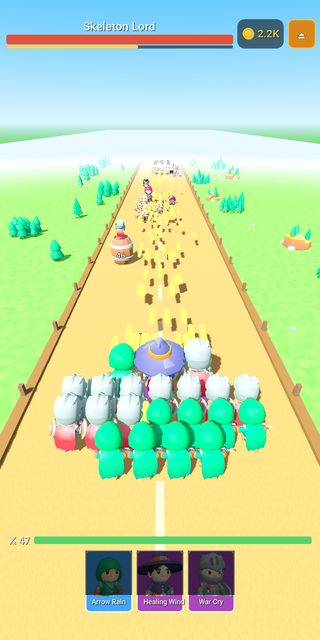
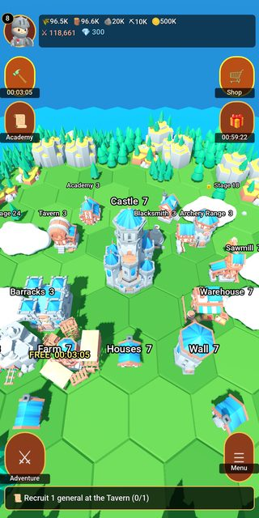
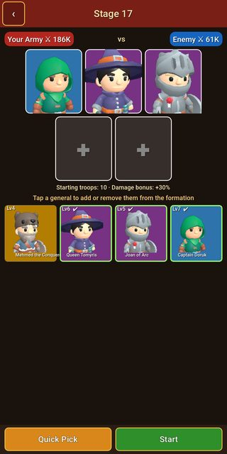
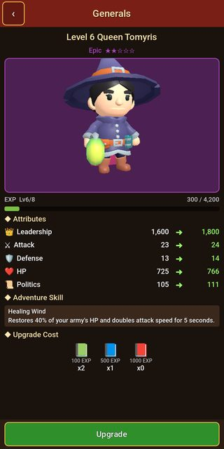
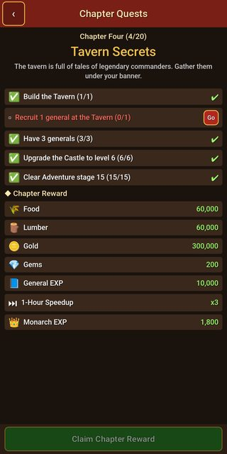

# Crownlune: Kingdom Wars

A 3D kingdom adventure for Android: lead your army, rescue legendary rulers and rebuild your kingdom. Plays offline, no ads.

[Türkçe](#türkçe) · [Privacy policy](privacy.md)

  
  
  
  
  
  

Battle · Your city · Desert · Formation · Generals · Chapter quests

## Download

- **Android:** coming to Google Play.

## Features

- **Adventure:** swipe to lead your army down the road, smash barrels to free soldiers and pick the right gates: more troops, more attack, faster shots, critical hits. Every region ends with a boss.
- **Your city:** build and upgrade 17 buildings on a 3D island, from farms and a sawmill to barracks, blacksmith, tavern and academy. Your city makes you stronger in battle, and the fog lifts as you progress.
- **Legendary generals:** summon historical commanders such as Joan of Arc, Leonidas, Sun Tzu, Hannibal, Saladin, Mehmed the Conqueror and Alp Arslan. Rare, Epic and Legendary generals have stars, levels and battle skills like Arrow Rain, Healing Wind and War Cry. Follow clues to rescue captive rulers like Queen Tomyris and Hayreddin Barbarossa.
- **A story to finish:** 20 chapters with their own quests and rewards across 4 regions (the Misty Vale, the Scorching Desert, the Frost Peaks and the Dragonlands), then endless stages.
- **Made for every phone:** Low, Medium, High or Automatic graphics, smooth on older and budget phones. Plays offline, progress is saved on your phone. English and Turkish.

The game is free to play with no ads. Gems, offers, the Monthly Card and VIP are optional in-app purchases. Summon odds are shown in the tavern.

## Support

crownlune.app@gmail.com

3D models: [KayKit](https://kaylousberg.com/game-assets) by Kay Lousberg (CC0).

This repository holds the documentation only; the source code is not published here.

---

## Türkçe

Android için 3D krallık macerası: ordunu yönet, efsanevi hükümdarları kurtar, krallığını yeniden kur. İnternetsiz oynanır, reklam yok.

[Gizlilik politikası](privacy.md#türkçe)

Ekran görüntüleri (yukarıda): Savaş · Şehrin · Çöl · Dizilim · Generaller · Bölüm görevleri

### İndir

- **Android:** yakında Google Play'de.

### Özellikler

- **Macera:** parmağını kaydırarak ordunu yol boyunca yönet, fıçıları kırıp asker kazan, doğru kapıları seç: daha çok asker, daha çok saldırı, daha hızlı atış, kritik vuruş. Her bölgenin sonunda bir boss var.
- **Şehrin:** 3D bir adada 17 bina kur ve yükselt: çiftlikten kereste atölyesine, kışla, demirci, taverna ve akademiye. Şehrin savaşta seni güçlendirir, ilerledikçe sis kalkar.
- **Efsanevi generaller:** Jeanne d'Arc, Leonidas, Sun Tzu, Hannibal, Selahaddin Eyyubi, Fatih Sultan Mehmet, Alp Arslan gibi komutanları çağır. Nadir, Epik ve Efsanevi generallerin yıldızı, seviyesi ve Ok Yağmuru, Şifa Rüzgârı, Savaş Narası gibi yetenekleri var. İpuçlarını takip edip Kraliçe Tomris ve Barbaros Hayreddin gibi esir hükümdarları kurtar.
- **Bitirilecek bir hikâye:** 4 bölgede (Sisli Vadi, Kızgın Çöl, Buzul Dağlar, Ejderha Diyarı) kendi görevleri ve ödülleri olan 20 bölüm, ardından sonsuz aşamalar.
- **Her telefon için:** Düşük, Orta, Yüksek ya da Otomatik grafik; eski ve uygun fiyatlı telefonlarda da akıcı. İnternetsiz oynanır, ilerlemen telefonunda saklanır. Türkçe ve İngilizce.

Oyun ücretsizdir ve reklam içermez. Kıymetli Taş, teklifler, Aylık Kart ve VIP isteğe bağlı uygulama içi satın almalardır. General çağırma olasılıkları tavernada yazar.

### Destek

crownlune.app@gmail.com

3D modeller: [KayKit](https://kaylousberg.com/game-assets), Kay Lousberg (CC0).

Bu depoda yalnızca belgeler bulunur; kaynak kod burada yayımlanmaz.
